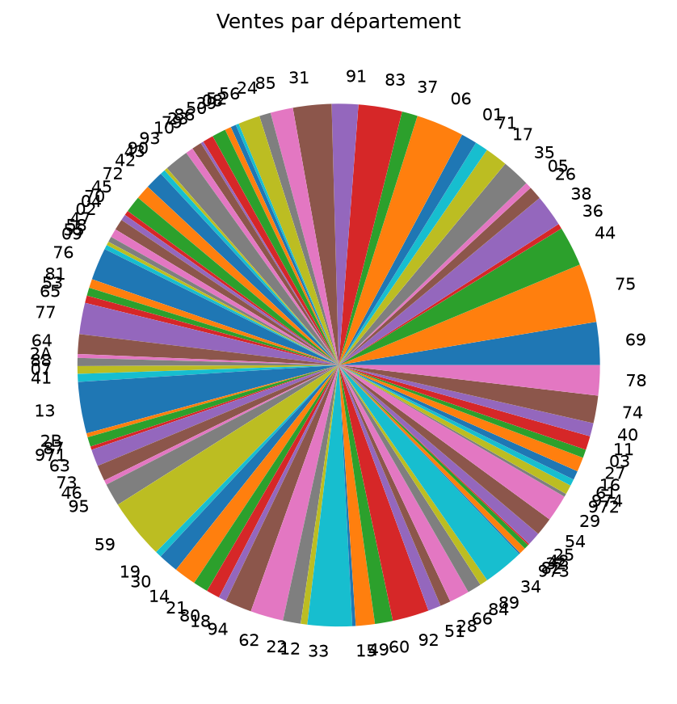
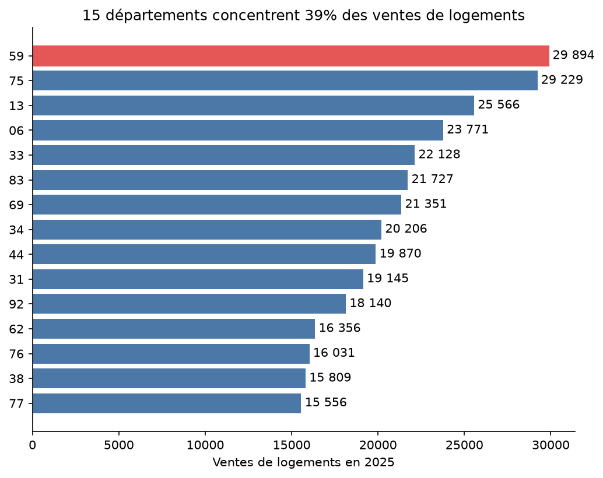

# Projet Data Viz : Où ouvrir la prochaine agence ? (DVF 2025)

Mastère Big Data & IA M1, Sup de Vinci, session 2026-2027
Enseignant : M. L. Ndao
Auteurs : Leslie AKONO, Ashley LONKING

> Du data lake au tableau de bord : un tableau de bord Streamlit construit sur les
> transactions immobilières françaises de 2025, avec une chaîne bronze / silver / gold,
> une ontologie et des requêtes SPARQL. Tout se lance avec `docker compose`.

## Sommaire

1. [Jeu de données](#1-jeu-de-données)
2. [Persona et question](#2-persona-et-question)
3. [Lancer le projet](#3-lancer-le-projet)
4. [Architecture et organisation du dépôt](#4-architecture-et-organisation-du-dépôt)
5. [Chaîne de traitement : bronze, silver, gold](#5-chaîne-de-traitement--bronze-silver-gold)
6. [Sémantique : ontologie et SPARQL](#6-sémantique--ontologie-et-sparql)
7. [Visualisation : avant / après](#7-visualisation--avant--après)
8. [Tableau de bord Streamlit](#8-tableau-de-bord-streamlit)
9. [Choix, limites et pistes](#9-choix-limites-et-pistes)
10. [Dépannage](#10-dépannage)
11. [Sources et licences](#11-sources-et-licences)
12. [État d'avancement](#12-état-davancement)

## 1. Jeu de données

**Demandes de valeurs foncières géolocalisées (DVF)**, publiées par Etalab à partir des
données de la DGFiP. Elles recensent les mutations (ventes) immobilières en France,
hors Alsace-Moselle et Mayotte. Ce sont des prix réellement signés chez le notaire,
pas des prix d'annonce.

| | |
|---|---|
| Source | https://www.data.gouv.fr/datasets/demandes-de-valeurs-foncieres-geolocalisees |
| Licence | Licence Ouverte / Open Licence 2.0 |
| Fichier utilisé | `full-2025.csv.gz`, livraison du 20/10/2026 |
| Période | année 2025 (1er janvier au 31 décembre) |
| Volume | 3 793 113 lignes de données, 40 colonnes (1 384 341 mutations) |
| Dimension temporelle | `date_mutation` |
| Dimension géographique | commune, département, latitude / longitude |
| Téléchargement | par script, sans compte ni clé : `scripts/download_dvf.py` (vérifie l'empreinte sha1 du fichier) |

Le fichier n'est pas versionné : le dossier `data/` est dans le `.gitignore`.

### 1.1 Comment lire le fichier

Une **ligne** correspond à un élément vendu, pas à une vente entière. Une **mutation**
(une vente, identifiée par `id_mutation`) occupe une ou plusieurs lignes :

```
Mutation (id_mutation)          prix, date, nature de la vente
 └── Parcelle (id_parcelle)     adresse, coordonnées
      └── Nature de culture     surface de terrain
           └── Local            type, surface bâtie, nombre de pièces
```

| Niveau | Colonnes | Comportement dans le fichier |
|---|---|---|
| Mutation | `id_mutation`, `date_mutation`, `nature_mutation`, `valeur_fonciere` | répétées à l'identique sur chaque ligne de la vente |
| Parcelle | `id_parcelle`, adresse, `longitude`, `latitude` | propres à chaque parcelle |
| Terrain | `surface_terrain`, `nature_culture` | **une valeur par nature de culture** de la parcelle, et non par parcelle |
| Local | `type_local`, `surface_reelle_bati`, `nombre_pieces_principales` | propres à chaque local ; vides pour un terrain nu |

### 1.2 Points d'attention pour le traitement

- **Prix** : `valeur_fonciere` est répété sur chaque ligne d'une mutation. Il faut le
  prendre une seule fois par `id_mutation`, sinon il est compté plusieurs fois.
- **Un même logement apparaît plusieurs fois** : une parcelle portant plusieurs natures de
  culture (sol, jardin, terre...) répète le logement une fois par nature. Sur 1 156 413
  lignes de logement, on compte 1 000 793 logements distincts. Sans déduplication, une
  maison comptée deux fois serait prise pour une vente de deux logements, ou aurait une
  surface doublée.
- **Terrain** : `surface_terrain` est une valeur par nature de culture ; elle ne se
  somme pas sans précaution.
- **Bâti** : la surface et les pièces ne se prennent que sur les lignes `Maison` et
  `Appartement`. Les dépendances et locaux industriels ou commerciaux sont à part.
- **Mutations multi-logements** : un seul prix pour plusieurs logements ne permet pas de
  calculer un prix au m² fiable ; ces ventes sont écartées.
- **Nature des transactions** : `nature_mutation` ne contient pas que des ventes
  (VEFA, échanges, adjudications, expropriations, terrains à bâtir). Le prix au m² médian
  diffère beaucoup selon la nature : 2 636 € pour les ventes, 4 666 € pour les VEFA.
- **Codes en texte** : `code_departement` (par exemple `01`) et `code_postal` perdent
  leur zéro initial s'ils sont lus comme des nombres.
- **Colonnes souvent vides** : lots, anciens codes commune et parcelle, suffixe
  d'adresse, numéro de volume.

### 1.3 Dictionnaire des colonnes

Le fichier contient 40 colonnes. Les noms ci-dessous suivent l'en-tête réel du fichier
`full-2025.csv`.

**Mutation**

| Colonne | Description |
|---|---|
| `id_mutation` | Identifiant de mutation (non stable d'une livraison à l'autre), sert à grouper les lignes |
| `date_mutation` | Date de la mutation, format AAAA-MM-JJ |
| `numero_disposition` | Numéro de disposition |
| `nature_mutation` | Nature de la mutation |
| `valeur_fonciere` | Prix de la mutation en euros |

**Adresse et localisation**

| Colonne | Description |
|---|---|
| `adresse_numero` | Numéro de l'adresse |
| `adresse_suffixe` | Suffixe du numéro de l'adresse (B, T, Q...) |
| `adresse_code_voie` | Code FANTOIR de la voie (4 caractères) |
| `adresse_nom_voie` | Nom de la voie |
| `code_postal` | Code postal (5 caractères) |
| `code_commune` | Code commune INSEE actuel (5 caractères) |
| `nom_commune` | Nom actuel de la commune |
| `ancien_code_commune` | Code INSEE d'origine, si différent du code actuel |
| `ancien_nom_commune` | Nom d'origine, si le code commune a changé |
| `code_departement` | Code département INSEE |
| `longitude`, `latitude` | Centre de la parcelle concernée |

**Parcelle**

| Colonne | Description |
|---|---|
| `id_parcelle` | Identifiant de parcelle actuel |
| `ancien_id_parcelle` | Identifiant d'origine, si différent de l'actuel |
| `numero_volume` | Numéro de volume |
| `code_nature_culture`, `nature_culture` | Nature de la parcelle (code et libellé) |
| `code_nature_culture_speciale`, `nature_culture_speciale` | Nature de culture spéciale |
| `surface_terrain` | Surface du terrain, par nature de culture |

**Local**

| Colonne | Description |
|---|---|
| `code_type_local`, `type_local` | Type de local (maison, appartement, dépendance...) ; vide pour un terrain |
| `surface_reelle_bati` | Surface réelle du bâti |
| `nombre_pieces_principales` | Nombre de pièces principales du logement |

**Lots (copropriété)**

| Colonne | Description |
|---|---|
| `nombre_lots` | Nombre de lots |
| `lot1_numero` à `lot5_numero` | Numéro de chaque lot (jusqu'à 5) |
| `lot1_surface_carrez` à `lot5_surface_carrez` | Surface Carrez de chaque lot |

### 1.4 Colonnes utilisées pour répondre à la question du persona

La silver conserve 14 colonnes : `id_mutation`, `date_mutation`, `nature_mutation`,
`valeur_fonciere`, `type_local`, `surface_reelle_bati`, `nombre_pieces_principales`,
`lot1_numero`, `code_departement`, `code_commune`, `nom_commune`, `id_parcelle`,
`longitude`, `latitude`.

## 2. Persona et question

**Claire, Directrice du Développement d'un Réseau d'Agences Immobilières.**

- **Ce qu'elle décide :** dans quels départements ouvrir une nouvelle agence ou renforcer
  les équipes existantes.
- **À quelle fréquence :** chaque trimestre, lors du comité d'investissement.
- **Ce dont elle a besoin :** repérer rapidement les territoires où l'activité est
  réelle, sans que les prix ne soient déjà hors de portée de la clientèle de son réseau.
  Elle décide aujourd'hui : elle a donc besoin de données récentes, d'où le choix de
  l'année 2025.

**Question principale :** dans quels départements le marché est-il actif (beaucoup de
ventes de logements) tout en restant accessible (prix médian au m² inférieur à la médiane
nationale), et comment cette activité évolue-t-elle mois par mois en 2025 ?

Définitions retenues : un département est **accessible** si son prix au m² médian est
inférieur à la médiane nationale. Il est **actif** s'il compte plus de ventes que le
centile choisi des départements (la médiane par défaut, réglable dans le tableau de bord).

## 3. Lancer le projet

**Prérequis** : Docker Desktop, Python 3.10 ou plus (pour le script de téléchargement), environ
10 Go d'espace disque et au moins 8 Go de mémoire alloués à Docker (la session Spark en utilise 4).

```powershell
# 1. Cloner le dépôt
git clone https://github.com/Databyolive/projet-dataviz-Leslie-Ashley.git
cd projet-dataviz-Leslie-Ashley

# 2. Créer le fichier de configuration (les valeurs par défaut conviennent)
Copy-Item .env.example .env

# 3. Télécharger les données (écrit data/raw/full-2025.csv, aucune clé requise)
python scripts/download_dvf.py

# 4. Démarrer les services
docker compose up -d
```

# il est necessaire d'installer les dependances   avant de continuer   pip install -r requirements.txt

5. **Exécuter les notebooks dans l'ordre** : ouvrir JupyterLab sur http://localhost:8890/?token=dvf
   (dossier `notebook/`), puis lancer *Run All* sur :

   | Ordre | Notebook | Rôle |
   |---|---|---|
   | 1 | `01_bronze.ipynb` | CSV brut vers Delta dans RustFS |
   | 2 | `02_silver.ipynb` | nettoyage, une ligne par vente |
   | 3 | `03_gold.ipynb` | agrégats, export vers PostgreSQL |
   | 4 | `04_sparql.ipynb` | graphe RDF d'un département et requêtes SPARQL (facultatif pour le tableau de bord) |
   | 5 | `05_exploration.ipynb` | graphiques et avant / après (facultatif) |
   | | `01b_exploration_bronze.ipynb` | contrôles de la bronze (facultatif) |

   Les notebooks 01 à 03 sont nécessaires au tableau de bord ; ils prennent plusieurs
   minutes. En cas d'erreur de mémoire Spark, redémarrer le kernel et relancer.

6. **Ouvrir le tableau de bord** : http://localhost:8502

| Service | Adresse | Identifiants |
|---|---|---|
| Tableau de bord Streamlit | http://localhost:8502 | |
| JupyterLab (Spark) | http://localhost:8890/?token=dvf | jeton `dvf` |
| Adminer (PostgreSQL) | http://localhost:8081 | système PostgreSQL, serveur `postgres`, base `dvf`, utilisateur `dvf`, mot de passe `dvf` |
| Console RustFS (lac) | http://localhost:9003 | `rustfsadmin` / `rustfsadmin` |
| Interface Spark | http://localhost:4041 | pendant l'exécution d'un notebook |

**Arrêter et relancer** : `docker compose stop`, puis `docker compose up -d`. Après une
modification du code du tableau de bord : `docker compose up -d --build dashboard`.
**Ne jamais utiliser `docker compose down -v`** : l'option `-v` supprime les volumes et donc
le lac Delta et la base PostgreSQL.

## 4. Architecture et organisation du dépôt

```
CSV brut ──> BRONZE ──> SILVER ──> GOLD ──> PostgreSQL ──> Streamlit
 (data/)     Delta      Delta      Delta     (3 tables)     (dashboard)
            (RustFS)   (RustFS)   (RustFS)
                          └──> graphe RDF ──> SPARQL
```

Cinq services Docker : `postgres` (base de la gold), `adminer` (interface de la base),
`rustfs` (stockage S3 du lac, avec `rustfs-init` pour les droits), `jupyter` (Spark et
notebooks) et `dashboard` (Streamlit).

```
projet-dataviz-Leslie-Ashley/
├── README.md
├── docker-compose.yml
├── .env.example               variables de configuration (le fichier .env n'est pas versionné)
├── requirements.txt           environnement Python complet du projet
├── app/                       tableau de bord Streamlit (image Docker)
│   ├── Dockerfile
│   ├── requirements.txt       dépendances de l'image du tableau de bord
│   ├── app.py                 l'application
│   ├── donnees.py             lecture de PostgreSQL, contours des départements
│   ├── kpi.py                 les cinq KPI : fiches et calculs
│   ├── illustrations.py       illustrations dessinées en SVG
│   ├── assets/                contours des départements (GeoJSON)
│   └── .streamlit/            thème
├── notebook/                  bronze, silver, gold, SPARQL, exploration
├── outils/source.py              session Spark, accès au lac RustFS
├── scripts/download_dvf.py    téléchargement des données
├── ontology/dvf.ttl           ontologie OWL
├── semantique/                scripts qui génèrent le schéma et les graphes de l'ontologie
├── docs/                      règles de nettoyage, fiches KPI, schémas, planning
└── data/                      données (non versionnées)
```

## 5. Chaîne de traitement : bronze, silver, gold

### Bronze

Le CSV est lu en texte, sans transformation, puis écrit en Delta dans
`s3a://dvf/bronze/dvf_2025`. Contrôle : le nombre de lignes de la bronze est égal à celui du CSV
(3 793 113).

### Silver : une ligne par vente

La silver sélectionne 14 colonnes, type les champs, puis applique sept règles. Chaque règle est
journalisée (lignes et ventes avant / après). Le détail et les justifications chiffrées sont dans
[`docs/regles_silver.md`](docs/regles_silver.md).

| Règle | Justification | Ventes avant → après | Retirées |
|---|---|---|---|
| R1 : nature = Vente | échanges, adjudications, VEFA et terrains à bâtir n'ont pas le même marché | 1 384 341 → 1 309 960 | 74 381 |
| R2 : prix > 0 | prix vides ou non convertibles | 1 309 960 → 1 262 958 | 47 002 |
| R3 : aucun autre local dans la vente | un prix couvrant dépendances ou locaux commerciaux ne donne pas un prix au m² de logement | 1 262 958 → 1 190 626 | 72 332 |
| R4a : au moins un logement | on étudie les logements | 1 190 626 → 865 488 | 325 138 |
| R4b : un seul logement distinct | un prix pour plusieurs logements ne se ramène pas à un prix au m² ; la déduplication évite de compter deux fois un logement répété par nature de culture | 865 488 → 824 809 | 40 679 |
| R5 : surface ≥ 9 m² | en dessous, les prix au m² sont aberrants (repère : décret 2002-120) | 824 809 → 824 407 | 402 |
| R6 : prix au m² entre 500 € et 30 000 € | écarte les ventes à 1 € et les surfaces de 1 à 2 m² vendues très cher | 824 407 → 804 803 | 19 604 |

**Résultat : 804 803 ventes**, soit 58,1 % des mutations de départ. La table est écrite dans
`s3a://dvf/silver/ventes_dvf_2025`.

### Gold : les agrégats du tableau de bord

La gold calcule, avec des **médianes exactes** (Spark), pour chaque département, type de bien
(Tous, Maison, Appartement) et mois :

| Table | Une ligne par | Lignes | Colonnes principales |
|---|---|---|---|
| `gold_departement` | département et type de bien | 291 | nombre de ventes, prix au m² médian, prix médian, surface médiane, écart à la médiane nationale, indicateur de fiabilité |
| `gold_departement_mois` | département, type de bien et mois | 3 492 | les mêmes mesures par mois |
| `gold_national_mois` | type de bien et mois | 36 | série nationale mensuelle |

Les tables sont écrites en Delta (`s3a://dvf/gold/`) puis exportées dans PostgreSQL. Un contrôle
vérifie que la somme des ventes de chaque table est égale à celle de la silver (804 803), et que le
nombre de lignes est identique dans le lac et dans PostgreSQL. Un département est jugé **peu
fiable** s'il compte moins de ventes que le seuil `SEUIL_VENTES` de `03_gold.ipynb`.

## 6. Sémantique : ontologie et SPARQL

L'ontologie [`ontology/dvf.ttl`](ontology/dvf.ttl) décrit les concepts du domaine :

- **classes** : `Mutation`, `Logement` (avec les sous-classes `Maison` et `Appartement`),
  `Parcelle`, `Commune`, `Departement` ;
- **relations** : une mutation *porte sur* un logement, situé *sur une parcelle*, *dans une
  commune*, qui *appartient à* un département ;
- **propriétés** : valeur foncière, date, prix au m², surface bâtie, nombre de pièces, coordonnées,
  codes et noms.

Le notebook `04_sparql.ipynb` transforme les ventes d'**un département** (la Gironde, `33`) en
triplets RDF avec `rdflib`, puis exécute quatre requêtes :

| # | Question pour Claire | Ce que montre la requête |
|---|---|---|
| 1 | Où se concentre l'activité dans le département ? | communes classées par nombre de ventes |
| 2 | Quelles communes actives sont moins chères que le département ? | communes de plus de 20 ventes dont le prix au m² moyen est sous celui du département |
| 3 | Quelle saisonnalité ? | ventes par mois |
| 4 | Maisons ou appartements ? | types découverts grâce à la hiérarchie de l'ontologie (sous-classes de `Logement`) |

La gold répond au niveau des départements ; le graphe permet de descendre au niveau des communes
d'un département retenu. Le comptage mensuel de la requête 3 est identique à celui de la gold,
ce qui valide les deux chemins de calcul.

**Visualiser l'ontologie** (pages HTML interactives, comme dans le cours) :

```powershell
python -m pip install pyvis rdflib
python semantique\generer_graphe_ontologie.py
start docs\ontologie_graphe.html
start docs\exemple_graphe.html
```

`ontologie_graphe.html` montre les classes, relations et attributs ; `exemple_graphe.html` dessine
25 ventes réelles du graphe (il faut avoir exécuté `04_sparql.ipynb` au préalable). Un schéma
statique est aussi disponible :


## 7. Visualisation : avant / après

Le notebook `05_exploration.ipynb` explore les tables gold (répartition des ventes, classement des
prix, tendance nationale, activité contre prix) et compare deux versions d'un même graphique.
Question posée : *où se concentrent les ventes de logements ?*

| Avant (version naïve) | Après (version corrigée) |
|---|---|
|  |  |

| Correction | Principe de perception |
|---|---|
| camembert remplacé par des barres | la longueur sur une échelle commune se lit mieux que l'angle ou l'aire |
| tri par valeur | l'ordre rend le classement immédiat |
| 97 parts réduites à 15 | limiter l'information à ce que l'œil traite |
| une couleur et un accent | la teinte distingue des catégories ; une teinte unique avec un accent guide l'attention |
| valeurs écrites au bout des barres | étiquetage direct, moins d'effort de mise en correspondance |
| cadre allégé | réduire l'encre non informative |
| titre qui énonce le message | le titre dit ce qu'il faut voir |

## 8. Tableau de bord Streamlit

Adresse : http://localhost:8502. Le tableau de bord lit les trois tables gold dans PostgreSQL et
suit un récit en trois chapitres :

1. **Contexte** : le marché français en 2025 (ventes, prix médian, activité mois par mois).
2. **Constat** : carte des départements et nuage de points activité contre prix.
3. **Recommandation** : verdict sur le département choisi, ses cinq KPI, son évolution mensuelle
   comparée à la France, et la liste des départements actifs et accessibles.

**Cinq KPI**, chacun avec une fiche (définition, calcul, intérêt pour Claire, limites), affichée
dans l'application et rédigée dans `docs/kpi/` :

| KPI | Fiche |
|---|---|
| Ventes de logements (activité) | [`kpi_ventes_logements.md`](docs/kpi/kpi_ventes_logements.md) |
| Prix au m² médian | [`kpi_prix_m2_median.md`](docs/kpi/kpi_prix_m2_median.md) |
| Écart à la médiane nationale | [`kpi_ecart_mediane_nationale.md`](docs/kpi/kpi_ecart_mediane_nationale.md) |
| Prix médian d'une vente | [`kpi_prix_median_vente.md`](docs/kpi/kpi_prix_median_vente.md) |
| Évolution de l'activité (2ᵉ contre 1er semestre) | [`kpi_evolution_activite.md`](docs/kpi/kpi_evolution_activite.md) |

**Filtres interactifs** : type de bien, seuil d'activité (centile), masquage des départements peu
fiables, département analysé, variable colorant la carte.

## 9. Choix, limites et pistes

- **Médianes plutôt que moyennes** dans la gold et le tableau de bord : elles résistent aux ventes
  extrêmes. Les requêtes SPARQL comparent des moyennes, car SPARQL n'a pas de médiane.
- **Seuils de nettoyage** (9 m², 500 et 30 000 € par m²) justifiés par les distributions observées ;
  un seuil plus strict à 1 000 € par m² écarterait 8,7 % des ventes, surtout des maisons rurales bon
  marché, ce qui biaiserait la recherche de marchés accessibles.
- **Une seule année** : les évolutions sont des constats, pas des prévisions. Les creux et pics
  mensuels peuvent venir du calendrier ou de la saisie des actes.
- **Couverture** : DVF ne couvre ni l'Alsace-Moselle ni Mayotte (97 départements dans les données).
  Les départements d'outre-mer sont dans les tables mais pas sur la carte.
- **Graphe RDF limité à un département** pour rester léger ; l'instancier pour la France entière
  produirait plusieurs millions de triplets.
- **Pistes** : extension à 2024, jointure avec la population (ventes pour 1 000 habitants),
  chargement du graphe dans un serveur SPARQL (Fuseki).

## 10. Dépannage

| Symptôme | Cause probable | Que faire |
|---|---|---|
| la page du tableau de bord affiche une erreur de lecture PostgreSQL | tables gold absentes ou base arrêtée | exécuter `03_gold.ipynb`, puis `docker compose up -d` |
| `Py4JNetworkError`, `Connection refused` dans un notebook | processus Spark arrêté faute de mémoire | redémarrer le kernel, relancer les cellules dans l'ordre |
| `port is already allocated` | un port est pris par une autre application | modifier la partie gauche du port dans `docker-compose.yml` |
| `FileNotFoundError` sur `dvf.ttl` ou le CSV | fichier absent ou mal rangé | vérifier `ontology/dvf.ttl` et `data/raw/full-2025.csv` |
| le tableau de bord ne reflète pas une modification | ancienne image Docker | `docker compose up -d --build dashboard` |

## 11. Sources et licences

- **Données** : demandes de valeurs foncières géolocalisées 2025, Etalab / DGFiP, Licence Ouverte.
- **Contours des départements** : fichier simplifié du dépôt `gregoiredavid/france-geojson`.
- **Illustrations** du tableau de bord : dessinées pour le projet.
- **Outils** : Apache Spark, Delta Lake, RustFS, PostgreSQL, Streamlit, Plotly, rdflib, pyvis.

## 12. État d'avancement

- [x] Choix du jeu de données et du persona
- [x] Script de téléchargement (année 2025)
- [x] Bronze, silver, gold
- [x] Ontologie et requêtes SPARQL
- [x] Notebook d'exploration et avant / après
- [x] Tableau de bord
- [x] Recette sur un clone neuf, sur les deux postes